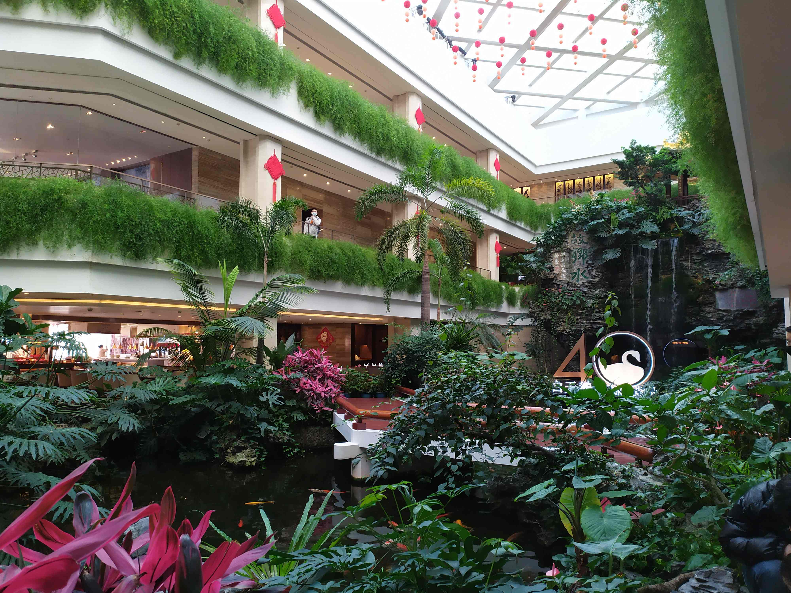
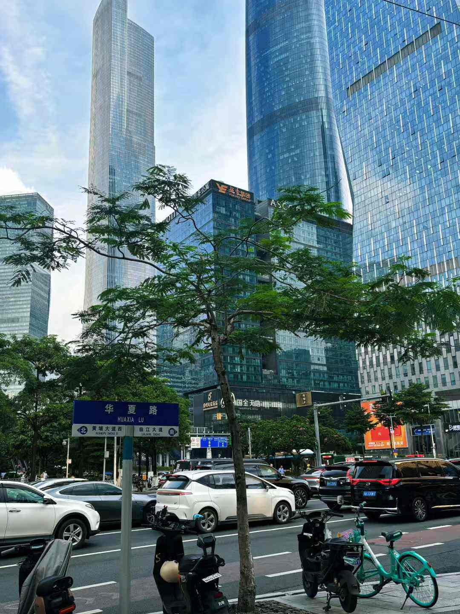
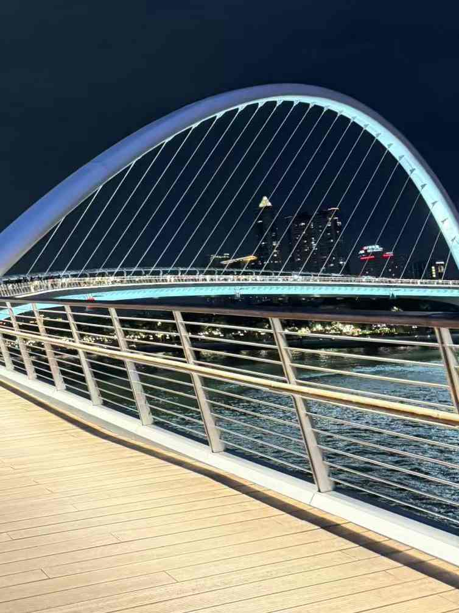
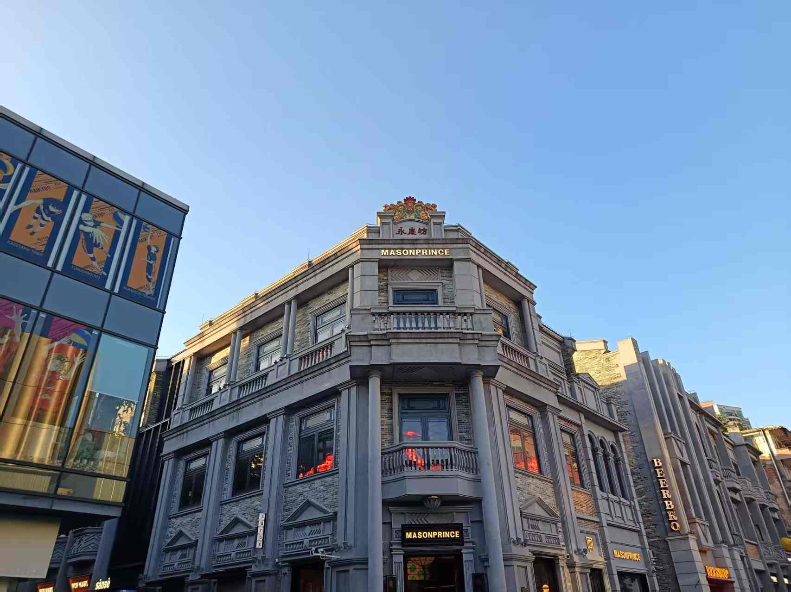

# 广州创新文化旅游路线 · 景点信息

> 本文件属于「广州四条主题旅游路线资料包」。配套图片见同目录 `图片/` 文件夹。
> 数据来源：原项目 `广州创新文化旅游路线/新旅游路径.html`、`广州创新文化旅游路线/交通方式备注.html`。
> 共 1 个主题日、8 处景点：精华景点 5 处，拓展景点 3 处。

## 总览

| 日程 | 主题 | 景点数 |
| --- | --- | --- |
| Day 1 | 创新文化主题游 | 8 |

返回：[资料包说明](../00-资料包说明.md)

---

## Day 1 · 创新文化主题游

**路线顺序**：白天鹅宾馆 → 开发区“开拓者”雕像 → 天河CBD双子塔（西塔+东塔） → 广州塔（小蛮腰） → 海心桥 → 永庆坊骑楼街 → 北京路步行街 → 广州大学城

### 1. 白天鹅宾馆（⭐ 精华景点）

**简介**：中国第一家中外合作五星级酒店，象征改革开放初期外资引入的制度破冰

- **地址**：荔湾区沙面南街1号
- **交通**：黄沙站（1/6号线）F出口，步行约8分钟至沙面岛
- **开放时间**：全天开放（餐饮及展馆开放时间以酒店公告为准）
- **参考评分**：4.8
- **延伸阅读**：[百度百科](https://baike.baidu.com/item/白天鹅宾馆) · [维基百科](https://zh.wikipedia.org/wiki/白天鵝賓館)
- **配图**：1 张，见下方

**详细介绍**

1. 总述：中国第一家中外合作五星级酒店（1983年），首座自行设计、建造、管理的五星级酒店，象征改革开放初期外资引入的制度破冰。酒店内部有广东特色早茶餐饮，是打卡吃住的最佳去处。

2. 筹建背景：1978年改革开放后，广东省率先引入外资。霍英东等港澳商人响应国家号召，与广东省政府合作投资酒店业。

3. 建设过程：选址广州沙面白鹅潭，由莫伯治等建筑师主持设计，融合现代建筑与岭南园林特色。1983年2月6日正式营业，邓小平、霍英东等出席开业典礼。1984年，邓小平视察广州时到访宾馆，并在28层远眺城市景观，肯定改革开放成果。1985年，成为中国首批三家五星级酒店之一（另两家为北京建国饭店、南京金陵饭店）。1990年，首次大规模装修升级。2000年起，作为广州城市地标，接待大量国际政商人士。2012年，因设施老化停业，启动全面改造。2015年，保留经典设计的同时升级科技与环保设施。2018年，入选"中国20世纪建筑遗产"名录。2023年，举办开业40周年庆典，被誉为"改革开放活化石"。

4. 创新举措：首创“敞开式大堂”设计和"中庭山水"景观，开创中国酒店空间设计新范式；国内首家对普通市民开放的五星级酒店，打破当时高档酒店仅接待外宾的惯例；引入国际标准管理，成为中国酒店业现代化标杆。

5. 意义：宾馆内设"改革开放展览馆"，展示其作为中外合作典范的历史。

### 2. 开发区“开拓者”雕像（📍 拓展景点）

**简介**：体现产业与科技双轨创新的“广州模式”，位于首批国家级经开区

- **地址**：黄埔区开发大道与志诚大道交叉口
- **交通**：地铁5号线或6号线换乘公交至开发区管委会站
- **开放时间**：全天开放（户外雕像）
- **参考评分**：4.5
- **延伸阅读**：[百度百科](https://baike.baidu.com/item/广州经济技术开发区) · [维基百科](https://zh.wikipedia.org/wiki/廣州經濟技術開發區)
- **配图**：暂无（原始资料中该景点未提供有效图片）

**详细介绍**

1. 总述：位于广州经济技术开发区（1984年首批国家级经开区），雕像以工人托举科技分子结构为造型，体现产业与科技双轨创新的“广州模式”。

2. 分述：1985年落成，最初设立在广州开发区管委会附近（夏港街道），成为开发区的精神象征。2000年后，随着开发区扩建，雕像曾多次迁移，但始终作为广州开发区的文化标志保留。2010年代，广州开发区成立30周年时，“开拓者”雕像被重新修缮，并在多个开发区重要场所复制展示，强化其象征意义。

### 3. 天河CBD双子塔（西塔+东塔）（📍 拓展景点）

**简介**：“垂直城市”典范，集聚金融总部与高端商业，体现城市建设和发展模式转向

- **地址**：天河区珠江西路5号（西塔）、珠江东路6号（东塔）
- **交通**：珠江新城站（3/5号线）A出口，直达花城广场
- **开放时间**：外观全天开放，内部商场及写字楼按各自规定开放
- **参考评分**：4.7
- **延伸阅读**：[百度百科](https://baike.baidu.com/item/广州国际金融中心) · [维基百科](https://zh.wikipedia.org/wiki/廣州國際金融中心)
- **配图**：1 张，见下方

**详细介绍**

1. 总述：西塔（广州国际金融中心）与东塔（周大福金融中心）构成“垂直城市”典范，集聚金融总部与高端商业。

2. 背景与规划：

（1）西塔：2005年立项，天河CBD加速建设，规划建设超高层地标，作为广州金融业的新象征。在设计竞赛中，英国威尔金森·艾尔中标，设计灵感来自“水晶体”，象征珠江的流动与广州的活力。

（2）东塔：2008年立项，作为珠江新城收官之作，与西塔形成“双子塔”格局。由美国KPF建筑事务所设计，灵感来自“通透水晶”，与西塔呼应。

3. 建设历程：

（1）西塔：2005年12月奠基动工，2007年主体结构施工（采用“钢管混凝土巨型框架+核心筒”结构，创多项国内建筑技术纪录），2009年12月封顶（440.75米，当时中国第二高楼），2010年9月正式启用，入驻四季酒店、高端写字楼等。

（2）东塔：2009年9月奠基，2011年主体施工（采用“巨型框架+核心筒+外伸臂”结构，抗震能力更强），2014年10月封顶（530米，当时中国第三高楼），2016年10月正式开业，入驻K11购物艺术中心、瑰丽酒店等。

4. 建筑特色：内部有甲级写字楼、五星级酒店（四季酒店）、高端商场（友谊商店）。

### 4. 广州塔（小蛮腰）（⭐ 精华景点）

**简介**：现代广州地标，塔身设计融入岭南“纤纤细腰”美学，体现高层建筑攻坚成果

- **地址**：海珠区阅江西路222号
- **交通**：广州塔站（3号线/APM线）A出口
- **开放时间**：9:30-22:30（具体时间以景区公告为准）
- **参考评分**：4.9
- **延伸阅读**：[百度百科](https://baike.baidu.com/item/广州塔) · [维基百科](https://zh.wikipedia.org/wiki/廣州塔)
- **配图**：1 张，见下方

**详细介绍**

1. 总述：现代广州地标，塔身设计融入岭南“纤纤细腰”美学，登顶可俯瞰珠江两岸新旧城区交融的景观。

2. 建设过程：又称“小蛮腰”，毗邻珠江新城。2005年11月25日正式动工兴建，2006年4月25日开始主体桩基础工程施工，2008年8月27日454米的主塔体完成封顶（超过中信广场成为广州最高建筑），2009年9月16日展开全球征名活动，2010年9月28日正式命名为广州塔，9月30日正式对外开放，10月1日起公开售票接待游客，并承担广州亚运会的转播任务。

3. 创新点：以“纤腰”曲线攻克超高层抗风难题，融合岭南剪纸艺术。塔顶有全球最高摩天轮（450米）及“极速云霄”速降项目，联动2024年新开业的广州塔广场呈现“水上塔影”景观。

4. 意义：作为中国第一高塔、世界第四高塔（截至2024年），它不仅是现代建筑工程的奇迹，更是广州城市形象的重要象征。

### 5. 海心桥（⭐ 精华景点）

**简介**：世界最宽曲梁斜拱人行桥，连接广州塔与二沙岛，体现桥梁技术攻坚成果

- **地址**：海珠区晴波路（二沙岛艺术公园旁）
- **交通**：广州塔站（3号线/APM线）A出口，步行约10分钟
- **开放时间**：7:00-23:00（具体时间以官方公告为准）
- **参考评分**：4.8
- **延伸阅读**：[百度百科](https://baike.baidu.com/item/海心桥) · [维基百科](https://zh.wikipedia.org/wiki/海心橋)
- **配图**：1 张，见下方

**详细介绍**

1. 总述：世界最宽曲梁斜拱人行桥（2021年开通），连接广州塔与二沙岛，也是广州中轴线步行系统的组成部分。

2. 建设历程：该桥由中国工程院院士、华南理工大学建筑设计研究院首席总建筑师何镜堂亲手设计打造，从2020年5月15日开始建造，2021年4月桥梁主体建成。5月13日，珠江两岸人行景观桥面向全球范围征名，6月25日建成开通，并命名为海心桥。

3. 创新点：因具有“曲、斜、难、大、高”的特点，出现主梁结构为三维曲面、梁拱制作安装精度要求高、线形控制严格三大难点，因此采用了三维成像技术和BIM技术等一系列新技术、新材料确保钢构件精准连接，实现了毫米级质量管控。海心桥是广州首个以智慧桥梁理念设计的人行桥，结合信息化、5G、BIM技术，可以及时预防报警拥挤等危险情况，实时提供讲解，为市民出行提供独一无二的通行、观景体验。此外，海心桥桥身如粤剧水袖舞动珠江，夜间灯光与沿岸地标形成“光影走廊”。

4. 意义：成为珠江两岸经济、商务、旅游发展的新纽带，市民观景、步行、休闲的新场所，根植岭南文化、展示广州风貌、顺应湾区发展的新名片。

### 6. 永庆坊骑楼街（⭐ 精华景点）

**简介**：广州保存最为完整的骑楼建筑群，西关骑楼微改造典范

- **地址**：荔湾区恩宁路99号
- **交通**：黄沙站（1/6号线）B出口，步行约5分钟
- **开放时间**：全天开放（商铺营业时间各异）
- **参考评分**：4.7
- **延伸阅读**：[百度百科](https://baike.baidu.com/item/永庆坊) · [维基百科](https://zh.wikipedia.org/wiki/永慶坊)
- **配图**：1 张，见下方

**详细介绍**

1. 总述：是广州保存最为完整的骑楼建筑群和中西合璧风格的民国建筑，西关骑楼微改造典范。

2. 改造历程：2016年，当地政府对永庆坊一期工程提出“微改造”理念，不搞大拆大建，下“绣花功夫”对老旧建筑进行修复活化。永庆坊一期于2016年完成。2018年底，永庆坊二期改造工程动工，改造面积是一期的10倍。经过一年多的升级改造，永庆坊二期逐步开放。永庆坊二期共分8个片区推进，分别为骑楼段、示范段、滨河段、粤博西段、粤博东段已于2021年完成，金声段于2022年6月完成。

3. 创新点：微改造，融合粤剧博物馆、非遗工坊与网红商业，保留满洲窗、青砖墙等传统元素，夜间开放粤剧演出。

4. 意义：增加客流量（2024年国庆日均客流达13.5万人次），实现传统与现代的融合。

### 7. 北京路步行街（📍 拓展景点）

**简介**：广州历史上最繁华的商业集散地，老城焕新标杆

- **地址**：越秀区北京路文化旅游区（北起广卫路，南至沿江中路）
- **交通**：公园前站（1/2号线）E出口直达北段；北京路站（6号线）B出口直达南段
- **开放时间**：全天开放（商铺营业时间各异）
- **参考评分**：4.6
- **延伸阅读**：[百度百科](https://baike.baidu.com/item/北京路步行街) · [维基百科](https://zh.wikipedia.org/wiki/北京路步行街)
- **配图**：1 张，见下方

**详细介绍**

1. 总述：广州历史上最繁华的商业集散地，路面下可见从唐至民国十一层路面遗址（有玻璃罩展示），有众多老字号和新潮店铺。

2. 改造过程：1985年，大批时装店、皮具店、鞋店、精品店来到北京路。1997年，北京路改为双休日准步行街。1998年，改为周末和节假日步行街。2001年12月1日起，改为全天候步行街。2002年，在北京路步行街北段出土了大量砂岩石条与古城墙砖，2003年1月，经过整饬后的“古道遗址”正式对外开放，被誉为“中国第一条千年古道”。2006年，与法国香榭丽舍大道正式签约为友好街区。2013年12月，广州老字号一条街在北京路北段启市，汇聚16家广州人熟悉的老字号。2021年2月8日，广州市政府计划通过3年时间，开展步行街改造提升二期建设。

3. 创新点：

（1）文化活化：采用“一栋一策、修旧如旧”原则修复873栋骑楼，恢复岭南民国风貌，打造“开放式岭南建筑博物馆”，玻璃罩下展示唐代至民国十一层叠压的千年古道遗址，实现“半日穿越两千年”的时空对话。

（2）业态创新：集聚老字号品牌31家与国际首店65家，引入“橱窗剧场”、非遗市集、电竞嘉年华等场景，在文物旁演绎《海阔天空》等现代音乐，形成历史与潮流碰撞的沉浸式体验。

（3）科技赋能：2025年新开业的第一福珠宝旗舰店首创“文化+商业+科技”模式，设AI导览、非遗金工手作坊,推动非遗技艺市场化转化。

（4）空间革新：步行区南延260米至泰康路（远期至天字码头），串联大佛寺、南越王宫等景点；背街小巷如昌兴街改造为青年创客空间，形成“主街商业+里巷文创”的立体街区。

### 8. 广州大学城（⭐ 精华景点）

**简介**：华南地区高级人才培养、科学研究和交流的中心，教育模式变革典范

- **地址**：广州市番禺区小谷围街道（主体位于小谷围岛，南岸拓展区至新造镇）
- **交通**：大学城北站（4号线）、大学城南站（4号线/7号线），出站即达核心区
- **开放时间**：全天开放（各高校及场馆开放时间各异）
- **参考评分**：4.6
- **延伸阅读**：[百度百科](https://baike.baidu.com/item/广州大学城) · [维基百科](https://zh.wikipedia.org/wiki/廣州大學城)
- **配图**：暂无（原始资料中该景点未提供有效图片）

**详细介绍**

1. 总述：广州大学城是华南地区高级人才培养、科学研究和交流的中心，学、研、产一体化发展的国家一流大学园区，中国南部的“信息港”和“智力中心”。

2. 建设过程：2003年1月21日，广东省委书记张德江来到番禺的小谷围岛视察广州大学城建设前期准备工作，广州大学城建设全面启动。2003年1月22日，广州大学城建设指挥部成立，具体负责组织实施广州大学城的建设。2004年8月底，入驻高校的8000多名师生如期进驻。2004年9月初，31000多名新生和4000多名教师也相继进驻。广州大学城成功实现了开学招生。

3. 创新点：形成“城-组团-校区”三级空间结构，首创教学资源跨校共享模式（如课程互选、实验室共用）；保留南汉二、清代古村落与水乡风貌，整合岭南印象园、广东科学中心等景点，形成“历史+科技+生态”多元体验。

4. 意义：是国内规模最大的新建大学城之一，集聚12所高校，推动广东高等教育毛入学率从1999年不足12%跃升至全国前列；拥有国家超算广州中心、4个国家级孵化器，累计孵化企业超1200家，培育独角兽企业2家，2023年园区总产值达25亿元，被誉为粤港澳大湾区“智核”。

---

## 附录：路线交通衔接

### 全天行程
